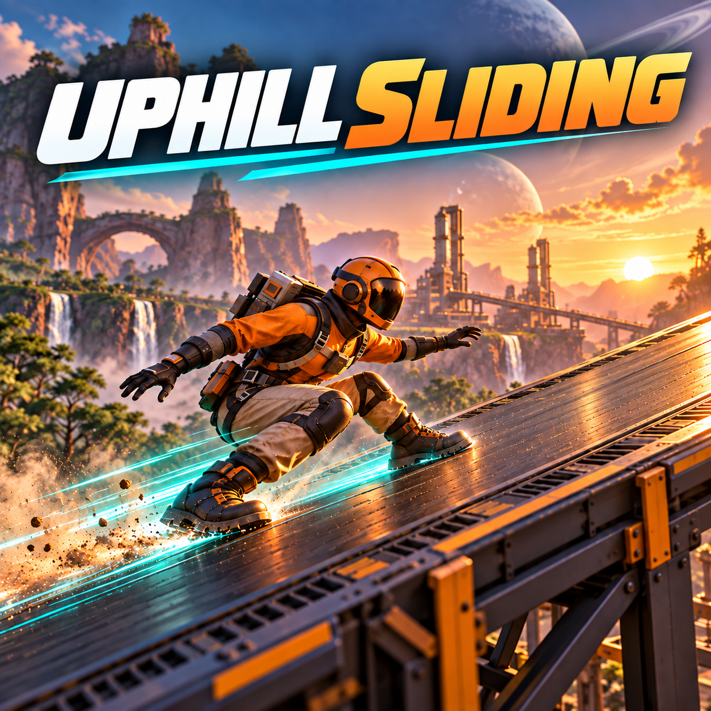

# Uphill Sliding

Keep your speed when the terrain turns uphill.

**Uphill Sliding** lets you continue sliding across uphill slopes in Satisfactory
without abruptly losing your horizontal momentum. Carry the speed you built on
a downhill stretch into the next incline, and keep chaining the game's existing
slide jumps across uneven terrain.

## Features

- Slide uphill on surfaces the game considers walkable.
- Preserve horizontal momentum when an incline would normally slow your slide.
- Release crouch or apply reverse movement input to brake.
- Use the normal crouch and jump controls; no unlocks or configuration required.
- Play in singleplayer or with matching mod versions on clients and the server.

The game's existing slide-jump boosts and downhill acceleration stay unchanged.

## Multiplayer

Version **1.1.0** adds multiplayer support. Install **the same version on every
player's client and on the dedicated server**, with compatible SML versions.
For directly hosted co-op, install it on both the host and joining players.

| Mode | Test status |
| --- | --- |
| Windows singleplayer | 1.1.1 passed on 2026-10-12, Epic Windows; uphill sliding worked with no reported issues |
| Linux dedicated server | 1.1.1 functional test passed on 2026-10-12 |
| Windows dedicated server | 1.1.1 functional test passed on 2026-10-12 |
| Directly hosted co-op | Supported by the code; host/guest session not yet tested |

All three 1.1.1 tests were completed on **2026-10-12** with the **Epic Games
Windows client**, **Satisfactory 1.2.4.1 (build 513885)** and **SML 3.12.0**.
These are manual author confirmations, not independent recordings. Steam client
builds passed; Steam runtime, co-op, systematic latency/packet loss, two simultaneous
players, collision and respawn remain untested. See [TESTING.md](TESTING.md) for
version-specific evidence and the earlier 1.1.0 results.

## Download

[Mod page on ficsit.app](https://ficsit.app/mod/FKXKumYqzkUAhw) ·
[GitHub releases](https://github.com/kellykiller/Uphill-Sliding/releases)

The **1.1.1** GitHub release includes Windows clients and Windows/Linux dedicated
servers in `UphillSliding.zip`. Install versions available on ficsit.app through
the **Satisfactory Mod Manager** and check the selected version on every client
and server. The old **1.0.0** package supports singleplayer only.

## Source code

This repository contains the complete mod plugin, C++ source and assets.
Place it in `Mods/GameFeatures/UphillSliding` inside a compatible Satisfactory
Modding project using **Unreal Engine 5.6.1-CSS** and matching SML headers.
See [BUILDING.md](BUILDING.md) for build/setup and [TESTING.md](TESTING.md) for
version-specific test results. Source code is licensed under [MIT](LICENSE).

Version **1.1.1** renames the native module to `UphillSliding` without changing
gameplay. Native builds, Alpakit packaging, archive checks and singleplayer/dedicated
functional tests passed. Existing 1.0.0 and 1.1.0 release packages remain unchanged.

## Bug reports

[Open an issue](https://github.com/kellykiller/Uphill-Sliding/issues) with your
game/mod versions, session type and steps to reproduce the problem.

---
Created by **Kellykiller** with assistance from OpenAI ChatGPT/Codex for code,
artwork and documentation.
